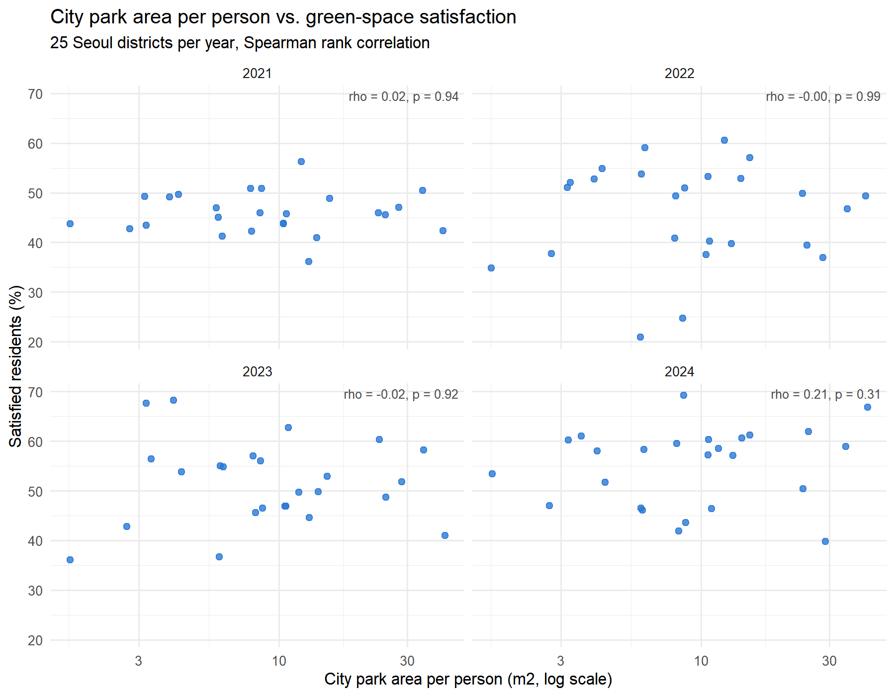
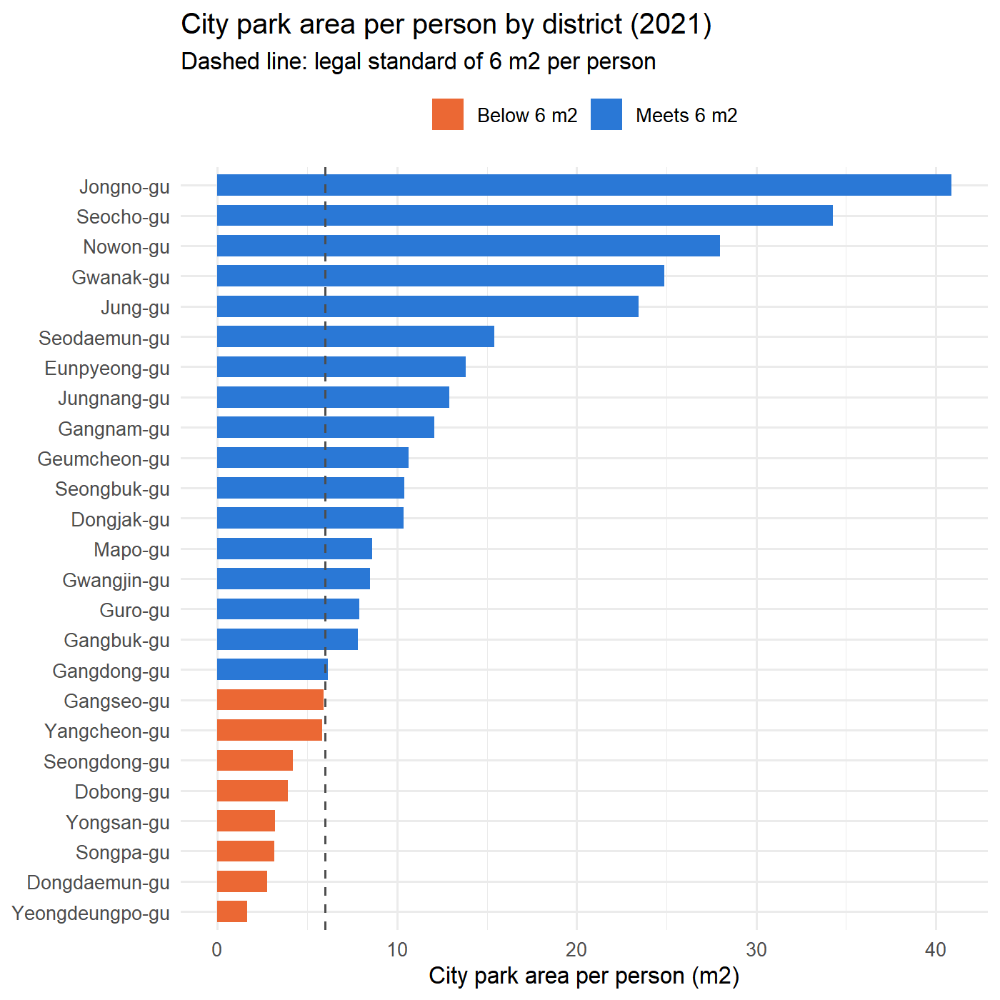
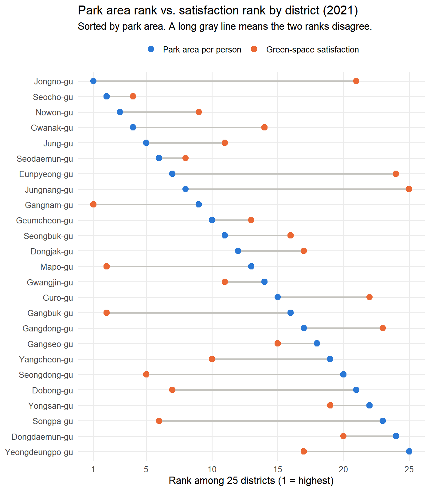

# Assessing Park Satisfaction through Data Integration and Correlation Analysis in R

Combined three public datasets covering Seoul’s 25 districts to test whether greater park area per capita is associated with higher satisfaction with urban green spaces. Found no meaningful relationship in any of the four years analyzed.

- **Type:** Course project (individual), 2022; reanalyzed in 2026
- **Tools:** R (dplyr, tidyr, ggplot2)
- **Methods:** data integration, Spearman rank correlation
- **Portfolio page:** [link]

---

## 1. Goal

Korean law sets a standard of 6 m² of urban parkland per person, and park policy is often evaluated based on the amount of parkland available in each district. However, more parkland does not necessarily mean greater resident satisfaction with green spaces. Using public data from Seoul’s 25 districts from 2021 to 2024. This project asked:

1. Which districts fall below the standard of 6 m² of urban parkland per capita?
2. Are residents more satisfied with green spaces in districts with more parkland per capita?
3. Did resident satisfaction increase in districts where parkland area grew?

**Background:** I first planned this analysis in a 2022 landscape information course using 2021 data. I later rebuilt it in R and extended it to four years to see whether the results held over time.

## 2. Data

Three public datasets from the [Seoul Open Data Plaza](https://data.seoul.go.kr), 25 districts × 4 years (2021–2024). The files are included in `data/`.

| File | Dataset | Used |
|---|---|---|
| `park_rate.csv` | Seoul park statistics: park ratio | District area, park area |
| `park_per.csv` | Seoul park statistics: park area per person | **City park area per person (m²)** |
| `satisfaction.csv` | Seoul regional satisfaction survey: green space | **Share of residents satisfied (%)** |

**Measures**
- **Park area:** ark area per capita (m²) assessed against the 6 m² standard.
- **Satisfaction:** the percentage of residents who were somewhat or very satisfied with green spaces.
- 
## 3. Data integration

The downloaded tables have multi-row headers (year in the first row, items in the next rows). The function `read_stat()` reshapes each table into one row per district and year, then the three tables are joined by district and year.

- Dropped non-district rows (Seoul total, Seoul Grand Park).
- Kept only district-level rows from the satisfaction survey.
- Replaced "-" (no data) with 0 in the park tables.
- Checked that all 25 districts are present in every year (`stopifnot`).
- Added English district names (e.g., 종로구 → Jongno-gu).
- Saved the merged table as `data/green_merged.csv`.

## 4. Analysis

[`green_analysis.R`](green_analysis.R) runs every step and prints the results.

| Step | What it checks | Method |
|---|---|---|
| 1 | Districts below 6 m² per person, and their satisfaction | Group means (2021) |
| 2 | Park area per person vs. satisfaction, each year | Spearman rank correlation |
| 3 | Jongno-gu, the district with the most park area per person | Rank comparison across 4 years |
| 4 | Whether satisfaction ranks are stable between years | Rank correlation between years |
| 5 | Change in park area vs. change in satisfaction (2021 → 2024) | Spearman rank correlation |
| 6 | Figures | ggplot2 |

**Why Spearman:** it compares districts by rank rather than raw value. Calculated Spearman rank correlations for each year to reduce sensitivity to extreme values in districts such as Jongno-gu, and compared changes in park area and satisfaction from 2021 to 2024.

## 5. Results

| Year | Spearman rho | p-value | Mean satisfaction |
|---|---|---|---|
| 2021 | 0.02 | 0.94 | 45.9% |
| 2022 | −0.00 | 0.99 | 45.9% |
| 2023 | −0.02 | 0.92 | 51.6% |
| 2024 | 0.21 | 0.31 | 55.0% |

rho ranges from −1 to 1; values near 0 mean no relationship. p < 0.05 would mean the relationship is unlikely to be due to chance.

<p align="center">
  
</p>

### More park area did not mean higher satisfaction
In all four years, the rank correlation between park area per person and satisfaction was close to zero (rho −0.02 to 0.21), and none was statistically significant (p > 0.3).

### Meeting the legal standard made no difference
In 2021, 8 of 25 districts fell below 6 m² per person (Yeongdeungpo-gu was lowest at 1.66 m²). Their average satisfaction (46.3%) was almost the same as that of the 17 districts that met the standard (45.8%).

<p align="center">
  
</p>

### The district with the most park area was not the most satisfied
Jongno-gu ranked 1st in park area per person every year, but its satisfaction rank moved from 21st to 13th, 23rd and 2nd.

| Year | Park per person (m²) | Park area rank | Satisfaction | Satisfaction rank | Seoul mean |
|---|---|---|---|---|---|
| 2021 | 40.8 | 1 | 42.3% | 21 | 45.9% |
| 2022 | 41.0 | 1 | 49.4% | 13 | 45.9% |
| 2023 | 41.4 | 1 | 41.0% | 23 | 51.6% |
| 2024 | 41.7 | 1 | 66.8% | 2 | 55.0% |

<p align="center">
  
</p>

### Satisfaction changed for reasons other than park area
- From 2021 to 2024, park area per person barely changed (mean +0.21 m², range −0.52 to +1.04), while satisfaction rose by 9.1 percentage points on average (range −9.0 to +24.5).
- Districts whose park area grew did not see larger gains in satisfaction (rho = 0.06, p = 0.78).
- Satisfaction ranks also shifted a lot from year to year (rank correlation between years −0.25 to 0.33), so a district's satisfaction in one year says little about the next.

## 6. From analysis to decision

- **Who would use it:** city and district park planners who decide where to add or improve green space.
- **Don't treat the 6 m² standard as the end goal.** Park area per person did not track satisfaction, so it should not be the main target for raising residents' satisfaction.
- **Look at what area figures miss,** such as how close parks are to homes, how easy they are to use, and how well they are maintained.

**Limitations**
- With only 25 districts, weak relationships are hard to detect, so the result means no clear relationship was found, not that none exists.
- District averages can hide differences between neighborhoods within the same district.
- Satisfaction ranks changed a lot from year to year, which suggests that survey sampling may add noise.
- Next step: analyze at the neighborhood level and add measures of park access and quality, such as walking distance to the nearest park.

## 7. How to run

```r
install.packages(c("dplyr", "tidyr", "ggplot2"))
```

Open the repository folder as the working directory (in RStudio: *Session → Set Working Directory → To Source File Location*), then run:

```r
source("green_analysis.R")
```

Tested with R 4.3.3 (dplyr 1.1.4, tidyr 1.3.1, ggplot2 3.4.4).

## Repository structure

```
├── README.md
├── green_analysis.R                 # all steps, prints results and saves figures
├── data/
│   ├── park_rate.csv           # raw: park ratio
│   ├── park_per.csv            # raw: park area per person
│   ├── satis.csv               # raw: green-space satisfaction
│   └── green_merged.csv             # created by the script
└── figures/
    ├── 01_citypark_per_2021.png
    ├── 02_area_vs_satisfaction_by_year.png
    └── 03_area_vs_satisfaction_rank_2021.png
```

## Note on AI assistance

I used AI tools ([tool names]) for coding help while rebuilding the analysis in R and to translate comments into English. The research question, choice of measures and interpretation are my own.
